<p align="center">
  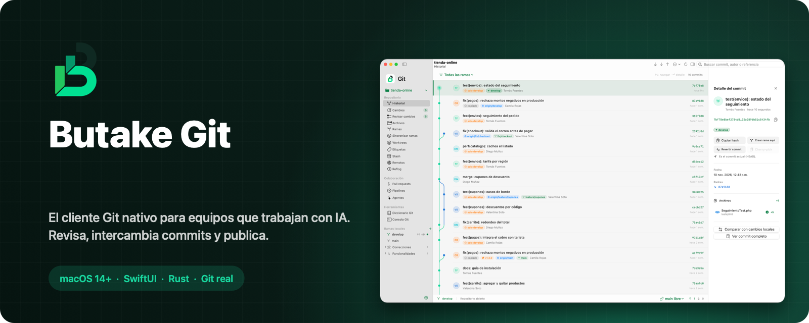
</p>

<p align="center">
  <a href="LICENSE"></a>
  
  
  
  
  <a href="CONTRIBUTING.md"></a>
</p>

<p align="center">
  <a href="https://github.com/Jose-Currinir/Butake-Git/releases/latest/download/Butake-Git.dmg"><b>⬇︎ Descargar para Mac</b></a> ·
  <a href="https://jose-currinir.github.io/Butake-Git/"><b>Sitio web</b></a>
</p>

<p align="center">
  <a href="#-por-qué-butake-git">Por qué</a> ·
  <a href="#-recorrido">Recorrido</a> ·
  <a href="#-seguridad">Seguridad</a> ·
  <a href="#-rendimiento">Rendimiento</a> ·
  <a href="#-instalar">Instalar</a> ·
  <a href="#-contribuir">Contribuir</a>
</p>

---

## 💡 Por qué Butake Git

Los clientes Git tradicionales se diseñaron para cambios hechos a mano: pocos archivos, un commit cada tanto. Hoy un agente de IA puede tocar **600 o 1.200 archivos en minutos**, y muchos equipos trabajan con **`main` y `develop` en paralelo**, intercambiando commits a diario.

Butake Git nace para ese flujo:

- 🔍 **Revisar lo que hizo la IA** archivo por archivo, sin perder el hilo aunque el agente siga cambiando cosas.
- 🔀 **Pasar commits entre ramas** con un clic, viendo qué falta en cada una y qué ya se copió.
- 🧹 **Ordenar la historia** (combinar, reordenar, editar mensajes) sin editor y con «Deshacer».
- 🟢 **Estar al tanto sin abrir la ventana**: cambios, commits por bajar y por subir, en el notch.
- 🇨🇱 **Hablar claro**: «Bajar cambios», «Subir cambios», «Tu versión / Versión entrante». Todo en español.

Usa el Git que ya tienes, con tus llaves SSH, tus hooks y tu gestor de credenciales. No reemplaza a Git: lo hace claro y seguro.

<table>
  <tr>
    <td width="33%" valign="top"><h3>⚡ Rápida</h3>1.500 archivos cambiados: refresco en ~100 ms, preparar todo en 0,3 s y scroll a 120 fps.</td>
    <td width="33%" valign="top"><h3>🤖 Hecha para IA</h3>Cambios en lista o por carpetas para lotes enormes de un agente, fluido con miles de archivos y operable por agentes vía accesibilidad.</td>
    <td width="33%" valign="top"><h3>🛡️ Segura</h3>Confirmación antes de cada cambio, force push bloqueado, argumentos sin shell y tokens sólo en el llavero.</td>
  </tr>
  <tr>
    <td valign="top"><h3>🍎 Nativa</h3>SwiftUI y AppKit, sin WebView. Vidrio de macOS, modo claro y oscuro, menús del sistema en español.</td>
    <td valign="top"><h3>🌐 GitHub y Bitbucket</h3>Pull requests, checks, revisores, comentarios en línea, pipelines, clonar y publicar.</td>
    <td valign="top"><h3>✨ Código bonito</h3>Diff con colores de sintaxis, cambios marcados dentro de la línea y editor con números de línea.</td>
  </tr>
</table>

---

## 🧭 Recorrido

### Historial

El grafo muestra cómo se ramifica y se une el trabajo, con etiquetas de rama, tag y **«solo en develop / copiado»**. Al elegir un commit aparece su detalle: archivos con ícono y +/−, padres, copiar hash, crear rama, revertir, cherry-pick o comparar con tus cambios.

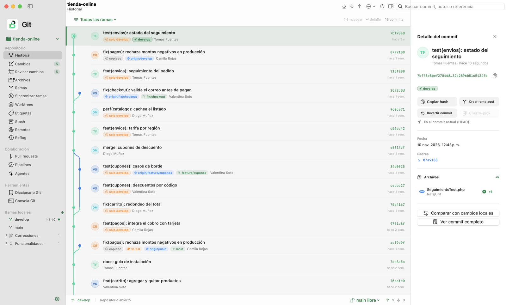

**Búsqueda con filtros:** escribe `@` en el buscador y elige un filtro; se combinan entre sí y con texto libre.

| Filtro | Muestra |
|---|---|
| `@autor:Camila` | commits de ese autor (sugiere autores con su cantidad de commits) |
| `@archivo:tarifa` | commits que tocaron archivos con ese nombre o ruta (sigue renombres si la ruta es exacta) |
| `@ext:.php` | commits que tocaron archivos con esa extensión |

También acepta `@author:`, `@file:` y `@extension:`. En Cambios, `@archivo:` y `@ext:` filtran la lista de archivos.

### Cambios y commit

Paneles **sin preparar** y **preparados**, con el tipo de cada cambio (Nuevo, Modificado, Eliminado, Movido, En conflicto) e íconos por lenguaje. Preparas un archivo, un bloque o todo de una vez; con <kbd>⇧</kbd>/<kbd>⌘</kbd> seleccionas varios para preparar o descartar juntos, y el clic derecho ofrece ver los commits de ese archivo. El compositor ayuda con el tipo (`feat`, `fix`…), el largo del mensaje y «Corregir el último commit».

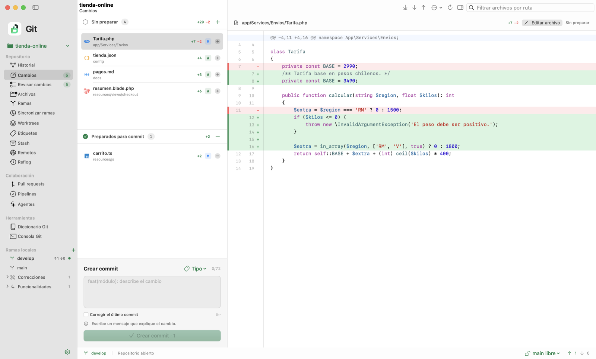

### Cambios por carpetas: hecho para lo que produce la IA

Los mismos cambios, vistos como **Lista** o como **Carpetas**. En Carpetas, cada casilla es «va en el commit»: marca un archivo o una carpeta entera y queda preparada; la casilla con «–» indica que sólo parte de la carpeta va. Mismo diff y mismo compositor en ambas vistas. Teclado: <kbd>↑</kbd><kbd>↓</kbd> recorrer · <kbd>Espacio</kbd> preparar o sacar · doble clic prepara.

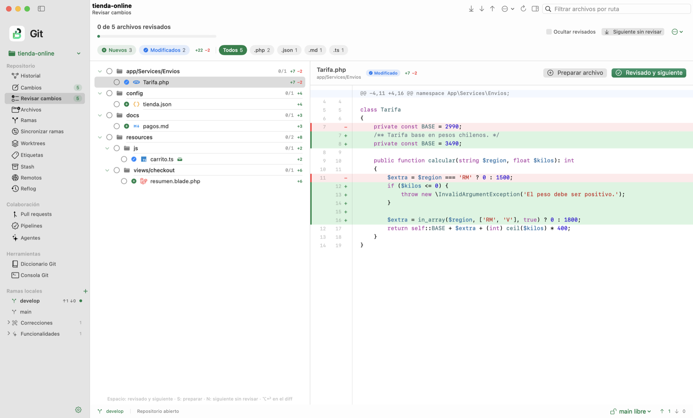

### Ver y editar código

<table>
  <tr>
    <td width="50%">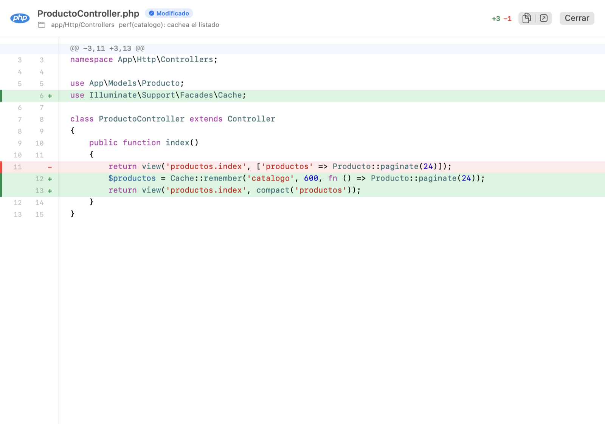</td>
    <td width="50%">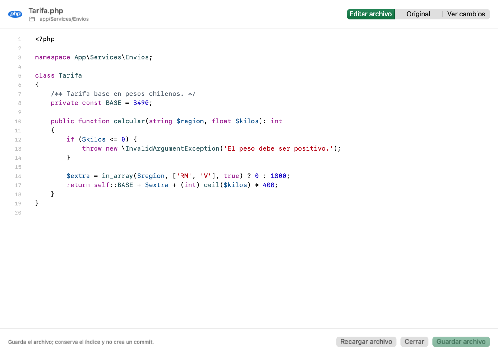</td>
  </tr>
  <tr>
    <td valign="top"><b>Diff legible</b>: colores de sintaxis para PHP, Blade, JS/TS, Python, Swift, Rust, Go, Java, Kotlin, C#, Ruby, CSS, HTML, Markdown, JSON, YAML, SQL y más; el <code>+</code>/<code>−</code> en el margen y <b>sólo la parte que cambió</b> resaltada.</td>
    <td valign="top"><b>Editor nativo</b>: números de línea, línea actual, sangría automática, sin comillas «tipográficas» y vista previa de Markdown. Al guardar comprueba que nadie más haya cambiado el archivo.</td>
  </tr>
</table>

Más de 600 íconos de archivo (Material Icon Theme): Laravel para Blade, Astro, Python, PHP, Docker, npm…

### Ramas, sincronizar y organizar

<table>
  <tr>
    <td width="50%">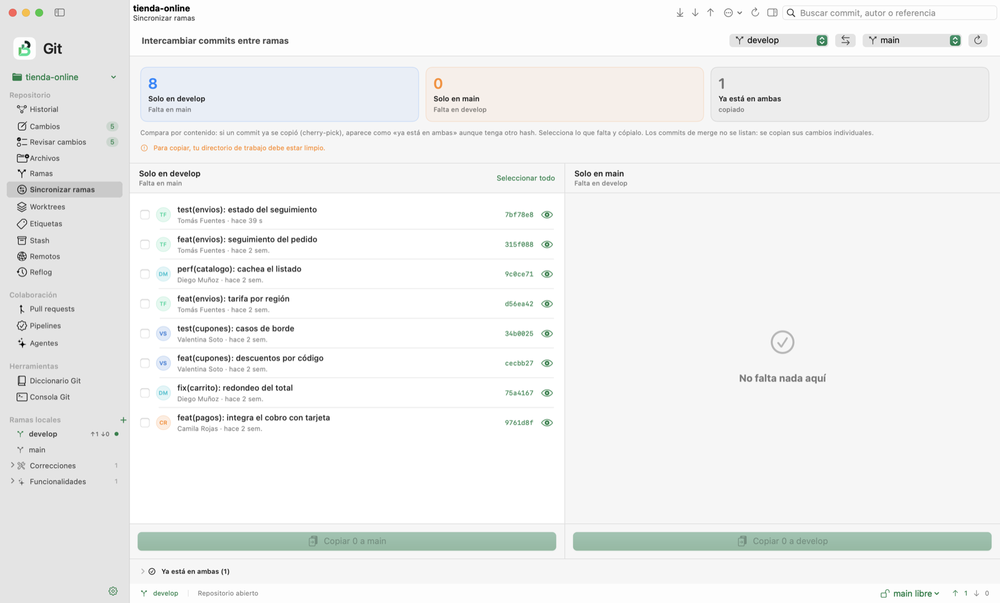</td>
    <td width="50%">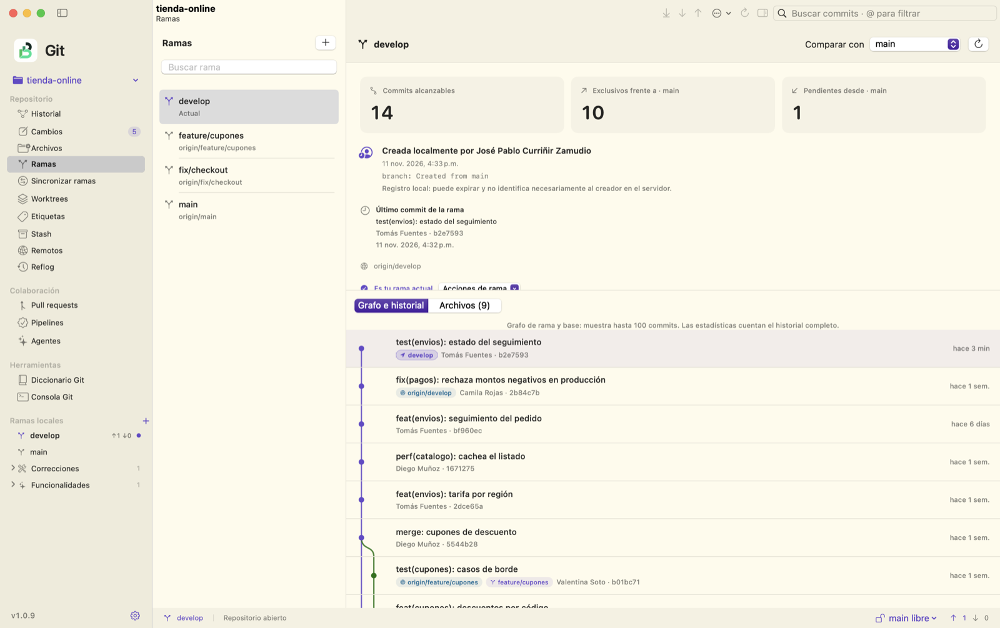</td>
  </tr>
  <tr>
    <td valign="top"><b>Sincronizar ramas</b>: compara <code>main</code> y <code>develop</code> <b>por contenido</b>. Un commit ya copiado con cherry-pick aparece como «ya está en ambas». Selecciona lo que falta y cópialo con un clic.</td>
    <td valign="top"><b>Ramas de cada repositorio</b>: detecta <code>main</code> o <code>master</code>, ramas remotas agrupadas por tipo, ↑/↓ por rama, crear, traer, renombrar y eliminar con doble confirmación si hay commits únicos.</td>
  </tr>
</table>

**Organizar commits**: combinar, reordenar arrastrando, editar mensajes o quitar commits no subidos, sin editor. Antes de aplicar se guarda un respaldo y «Deshacer» deja todo como estaba.

**Bajar y subir con red de seguridad**: si no se puede avanzar rápido, un asistente explica qué pasó y ofrece salidas claras; los conflictos se resuelven con «Tu versión», «Versión entrante» o «Usar ambas».

### Pull requests, checks y pipelines

Estado del PR y revisión pendiente, aprobada o con cambios pedidos. **Checks agrupados por lo que requieren** (con su duración), comentarios en línea con el código alrededor, sugerencias mostradas como −/+ y **«Arreglar con IA»**, que copia una instrucción lista para tu agente. Los tokens viven sólo en el llavero de macOS.

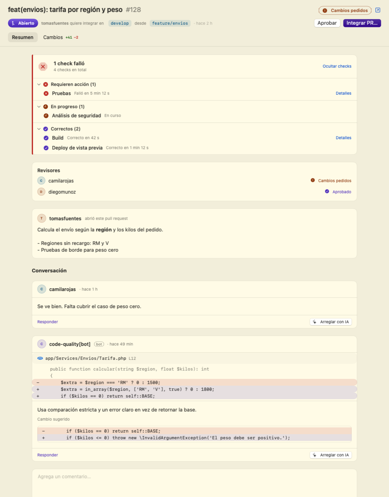

### El notch como centro de control

<table>
  <tr>
    <td width="55%">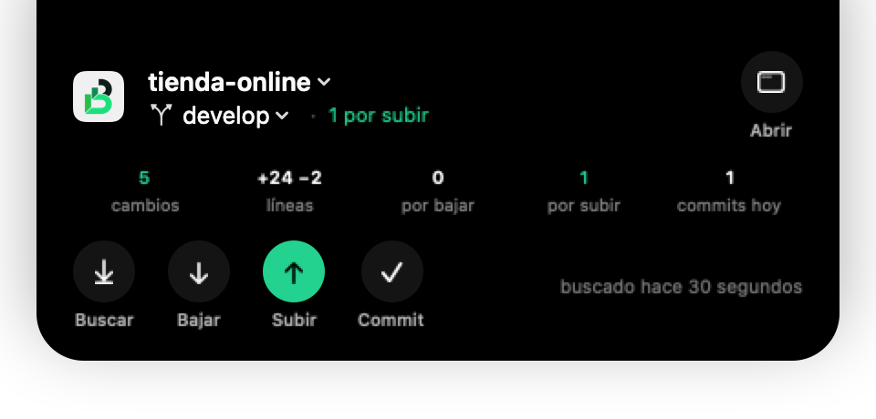</td>
    <td width="45%">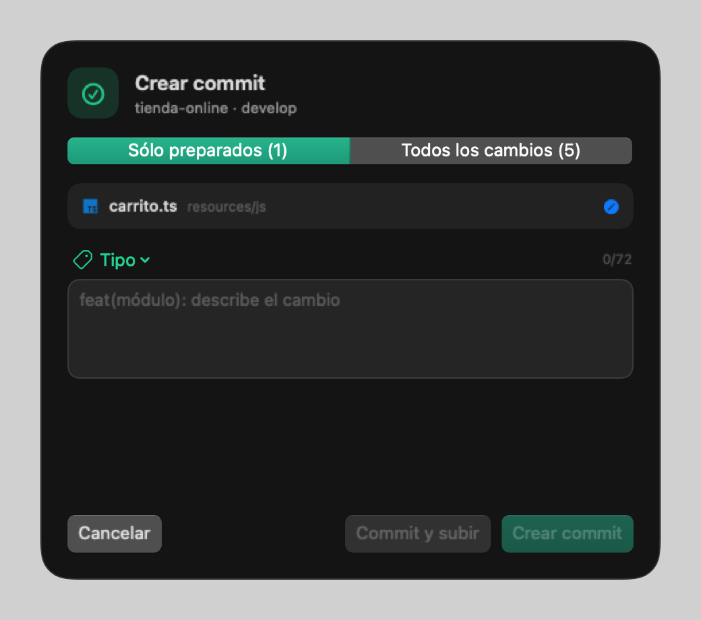</td>
  </tr>
</table>

Cambios y commits por bajar o subir junto a la cámara. Al pasar el cursor: cambiar de **repositorio** o **rama**, **buscar, bajar y subir** con confirmación en un panel flotante, y **hacer commit sin abrir la app**. Se desactiva en Ajustes o desde el mismo notch.

### Temas

**Butake Git** y **Drácula**, cada uno en claro y oscuro (o siguiendo al sistema). El tema cambia el acento, los fondos, los colores de cada tipo de cambio, el diff, el resaltado de código y el grafo de ramas. En Ajustes › General › Tema hay un **personalizador**: parte de un tema y cambia sus colores clave, con vista previa en vivo y valores separados para claro y oscuro.

### Crear, clonar y publicar

- **Nuevo repositorio** (<kbd>⌘N</kbd>): `main` (y `develop` si quieres) con un `.gitignore` para macOS. Tus archivos no se incluyen solos.
- **Clonar** (<kbd>⌘⇧N</kbd>): pega una dirección o elige de tus repositorios de GitHub y Bitbucket.
- **Publicar**: un repositorio sólo local se publica en tu cuenta o workspace en un paso, con los pasos explicados y confirmación.

### Y además

Archivos con editor · Worktrees · Etiquetas · Stash · Remotos · Reflog en lenguaje humano · Consola Git con terminal nativa · Diccionario de 152 comandos en español · Modo oscuro.

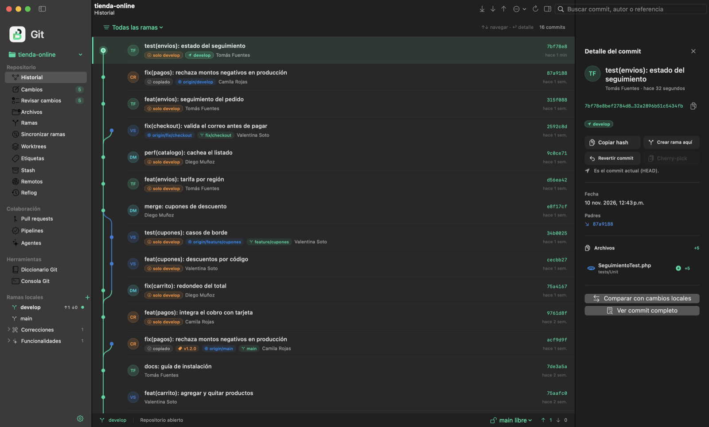

---

## 🛡️ Seguridad

- **Git sin shell**: cada comando recibe sus argumentos por separado; rutas, referencias y direcciones se validan.
- **Confirmación antes de cambiar algo**: subir, descartar, eliminar ramas, reescribir historia, publicar o ejecutar desde la consola muestra antes el comando exacto. Publicar y subir nunca se confirman con <kbd>↩</kbd>.
- **Force push y push masivo siempre bloqueados.**
- **Rama principal protegida según el remoto**: si GitHub o Bitbucket la protegen, Butake también.
- **Historia con respaldo**: organizar commits guarda una copia y permite deshacer.
- **Credenciales**: tokens sólo en el llavero de macOS; Git usa tu SSH Agent y tu gestor de credenciales.
- **Clonar y publicar sólo por https, ssh o git@.**

¿Encontraste un problema de seguridad? Lee [SECURITY.md](SECURITY.md).

## ⚡ Rendimiento

| Escenario | Resultado |
|---|---|
| Refresco con 1.500 archivos cambiados | **~100 ms** |
| Preparar o retirar 1.500 archivos | **~0,3 s** |
| Scroll del historial con 4.635 commits | **120 fps**, sin tirones |
| Scroll de Cambios con 1.500 archivos | **120 fps** |
| Ráfaga de 600 escrituras de un agente | **1 solo refresco** |

Medido en un Mac con Apple Silicon. Los cambios externos se detectan en vivo con FSEvents.

## 🤖 Operable por IA

Cada control relevante tiene un identificador de accesibilidad estable (`toolbar.pull`, `commit.message`, `review.next`, `notch.commit`…). Un agente de escritorio —o VoiceOver— puede manejar la app completa, y el motor también funciona sin interfaz. Detalle en [docs/automation.md](docs/automation.md).

## ⌨️ Atajos

| Atajo | Acción | Atajo | Acción |
|---|---|---|---|
| <kbd>⌘N</kbd> | Nuevo repositorio | <kbd>⌘↩</kbd> | Crear commit |
| <kbd>⌘O</kbd> | Abrir repositorio | <kbd>⌘⇧P</kbd> | Subir cambios |
| <kbd>⌘⇧N</kbd> | Clonar | <kbd>⌘⇧O</kbd> | Organizar commits |
| <kbd>⌘1</kbd>…<kbd>⌘5</kbd> | Historial, Cambios, Revisar, Ramas, Archivos | <kbd>⌘J</kbd> | Consola Git |
| <kbd>⌘R</kbd> | Actualizar | <kbd>⌘⇧D</kbd> | Diccionario |

---

## 📦 Instalar

**Descarga directa:** [Butake-Git.dmg](https://github.com/Jose-Currinir/Butake-Git/releases/latest/download/Butake-Git.dmg) (Mac con Apple Silicon, macOS 14+). Abre el `.dmg` y arrastra la app a Aplicaciones. Está firmada con Developer ID de Butake SpA y notarizada por Apple: abre sin advertencias.

**Actualizar:** desde la 1.0.4 la app avisa sola (junto a Ajustes) e instala la nueva versión tras verificar la suma SHA-256 y la firma. Si tienes una versión anterior (hasta la 1.0.3), actualiza sin desinstalar con:

```sh
curl -fsSL https://jose-currinir.github.io/Butake-Git/actualizar.sh | bash
```

El [script](scripts/actualizar.sh) descarga la última versión, comprueba la suma SHA-256, la firma Developer ID de Butake SpA y la notarización, cierra la app, la reemplaza (restaurando la anterior si algo falla) y la vuelve a abrir. `--forzar` reinstala la misma versión.

**Desde el código:** requiere Xcode Command Line Tools (Swift 6), Rust estable y Git.

```sh
git clone https://github.com/Jose-Currinir/Butake-Git.git
cd Butake-Git
./scripts/install-native.sh   # compila e instala en /Applications
```

Otros comandos: `./scripts/run-native.sh` (abrir sin instalar), `./scripts/test-native.sh` (pruebas) y `./scripts/package-dmg.sh` (instalador). Arquitectura, rendimiento y límites conocidos: [docs/desarrollo.md](docs/desarrollo.md).

```
SwiftUI / AppKit  ──JSON──▶  motor Rust  ──argumentos──▶  Git instalado
```

## 🗺️ Estado

Se usa a diario sobre repositorios reales. Todavía no hace: preparación por líneas sueltas, conflictos por bloque, integración de PR en pila ni actualizaciones automáticas. Ver la [matriz de funciones](docs/feature-matrix.md) y los [pendientes](docs/roadmap.md).

## 🤝 Contribuir

Las contribuciones son bienvenidas. **Nadie sube cambios directo**: haz un fork, crea una rama desde `develop` y abre un pull request hacia `develop`; el equipo lo revisa y aprueba antes de integrarlo. Para cambios grandes, abre antes un issue. Lee [CONTRIBUTING.md](CONTRIBUTING.md).

## 📄 Licencia y marca

Copyright 2026 Butake SpA. El código se publica bajo la [Licencia Apache 2.0](LICENSE); ver también [NOTICE](NOTICE).

El nombre **Butake**, el logo y la identidad visual son marcas de Butake SpA y **no** están incluidos en la licencia (sección 6). Puedes usar y modificar el código, pero una versión distribuida por terceros debe usar otro nombre y otro logo.

Incluye [Material Icon Theme](https://github.com/material-extensions/vscode-material-icon-theme) (MIT) y usa [SwiftTerm](https://github.com/migueldeicaza/SwiftTerm) (MIT).
